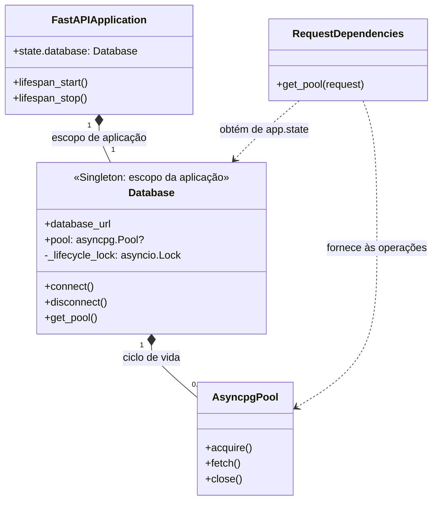
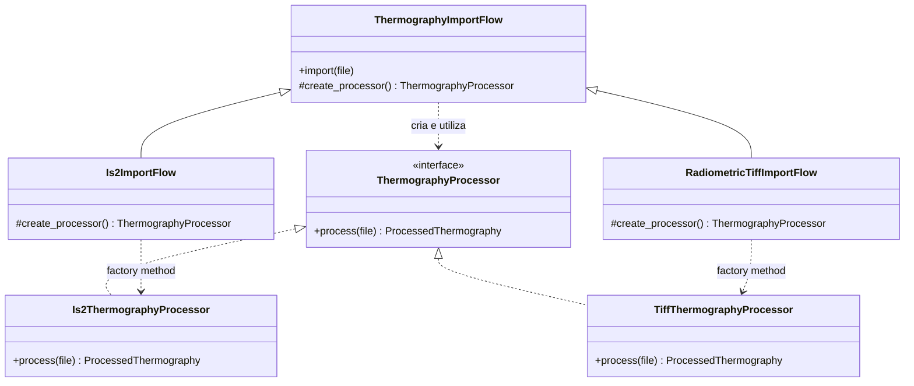
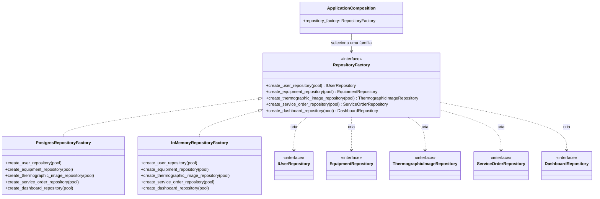
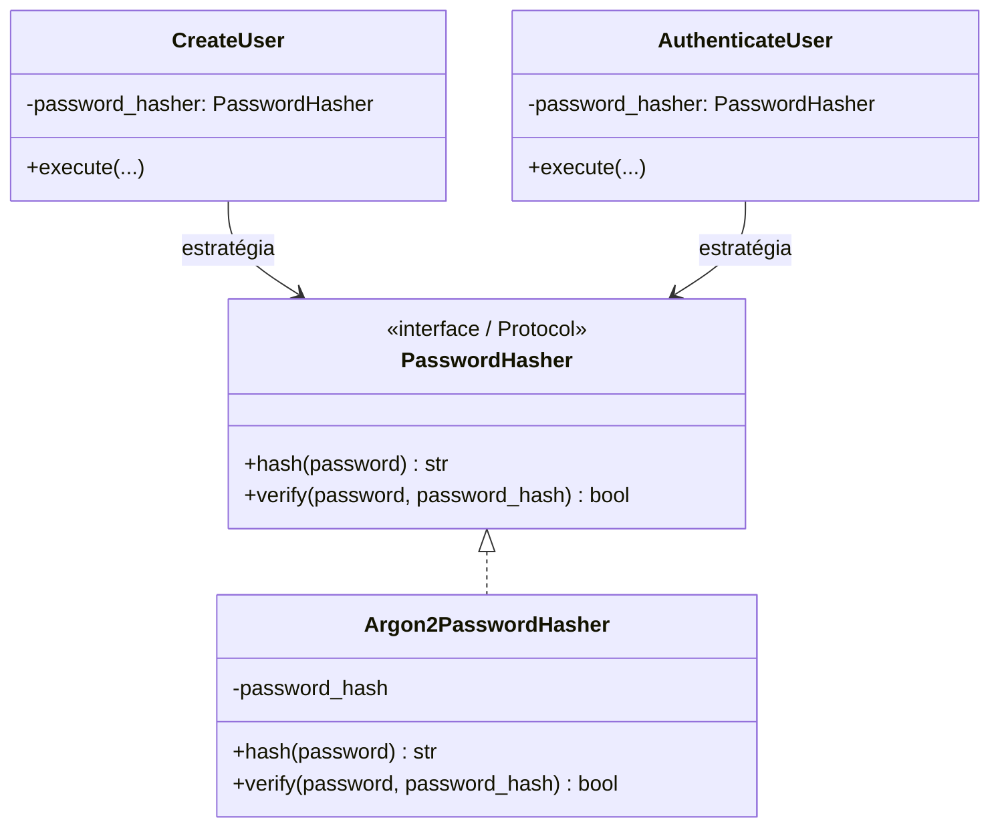
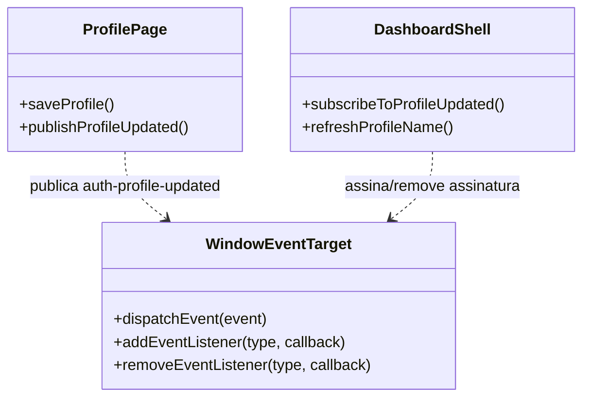
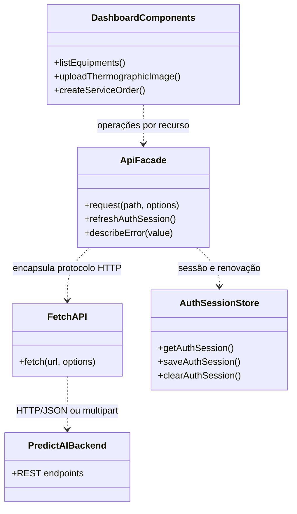
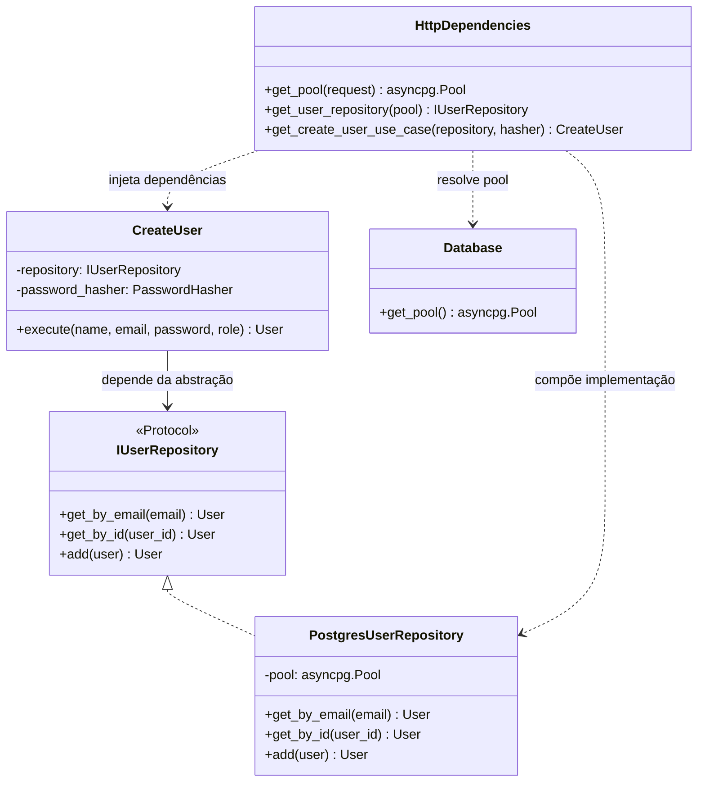
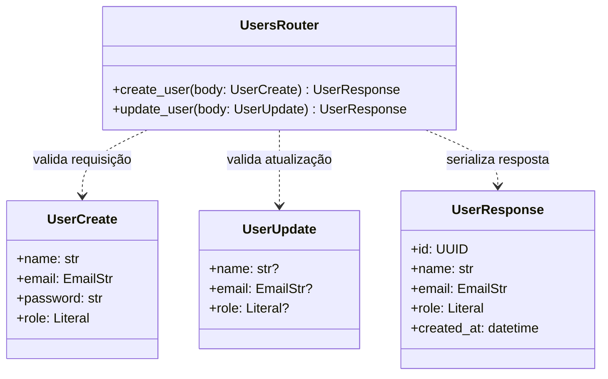

# Design patterns GoF no PredictAI Thermography

- **Revisado em:** 05/11/2026
- **Escopo:** padrões de projeto do catálogo GoF que têm evidência no código atual. Conceitos arquiteturais são identificados separadamente para evitar confusão de nomenclatura.

## 1. Padrões GoF encontrados

| Padrão | Categoria GoF | Onde aparece | Uso no sistema | Grau de aderência |
|---|---|---|---|---|
| **Strategy** | Comportamental | `backend/app/application/ports/password_hasher.py`; `backend/app/infrastructure/security/argon2_password_hasher.py`; `backend/app/presentation/http/dependencies.py`; `backend/app/application/use_cases/users/create_user.py` e `authenticate_user.py` | `PasswordHasher` define o contrato para calcular e verificar hashes. `Argon2PasswordHasher` é a estratégia concreta usada pelos casos de uso de cadastro e autenticação. Os casos de uso dependem do contrato, então a implementação criptográfica pode ser substituída sem reescrever a regra de cadastro/login. | **Claro no desenho, com uma estratégia concreta em produção.** A troca da estratégia é feita pela composição/dependência, não por seleção dinâmica dentro do caso de uso. |
| **Observer** | Comportamental | `frontend/components/dashboard/profile/profile-page.tsx` (publica `auth-profile-updated`); `frontend/components/dashboard/dashboard-shell.tsx` (assina o evento) | Depois que o perfil é atualizado, a tela publica um evento no `window`. O shell observa esse evento e atualiza o nome exibido na navegação. O emissor não chama diretamente o componente que precisa reagir. | **Uso localizado e explícito.** Há um evento e um consumidor conhecido; não existe um barramento geral de eventos no produto. |
| **Facade** | Estrutural | `frontend/lib/api.ts`, especialmente `request<T>()` e as funções públicas por recurso | O módulo oferece às telas uma interface simples para chamar a API. Ele centraliza URL base, serialização, autenticação, renovação concorrente de sessão, repetição após 401, tratamento de erros e mapeamento das respostas. Os componentes chamam funções como `listEquipments` ou `uploadThermographicImage` sem duplicar o protocolo HTTP. | **Claro como fachada do cliente HTTP.** O arquivo também funciona como módulo de serviços/API client; Facade descreve o papel simplificador perante os componentes. |

## 2. Usos parciais ou parecidos com GoF

Estes pontos têm semelhança com um padrão GoF, mas não devem ser tratados como implementação completa sem qualificação.

| Conceito | Onde aparece | O que o código faz | Por que é parcial |
|---|---|---|---|
| **Singleton, escopo da aplicação (pool)** | `backend/app/main.py` e `backend/app/infrastructure/database/postgres.py` | Cada aplicação FastAPI mantém um `Database` em `application.state.database`; esse objeto cria e compartilha um único `asyncpg.Pool` entre as requisições durante seu ciclo de vida. Um `asyncio.Lock` serializa a inicialização e o encerramento do pool. | É um Singleton gerenciado no escopo da aplicação, não um Singleton global GoF: `create_app(database=...)` permite injeção, e cada worker/réplica tem seu próprio pool. A configuração `settings = Settings()` é compartilhada por import, mas não é o dono do pool. |
| **Adapter, na integração Groq** | `backend/app/infrastructure/ai/groq_equipment_advisor.py` e endpoints de equipamento/termografia | O módulo monta requisições no formato Groq, chama HTTP, extrai JSON e entrega dados que os esquemas da aplicação validam como rascunho de OS. | A fronteira traduz formatos do provedor, lembrando Adapter. Porém, não há uma porta independente do fornecedor que defina o contrato esperado; os endpoints importam diretamente funções e configurações específicas da Groq. A integração continua acoplada ao provedor. |

## 3. Padrões arquiteturais presentes, mas fora do catálogo GoF

| Conceito | Onde aparece | Explicação |
|---|---|---|
| **Repository** | `backend/app/domain/repositories/user_repository.py`; implementações em `backend/app/infrastructure/persistence/postgres_*_repository.py` | Abstrai consultas e gravações persistentes. É um padrão de arquitetura/persistência, não um dos 23 padrões GoF. O contrato formal `IUserRepository` existe para usuários; outros repositórios são classes concretas usadas diretamente pelas rotas. |
| **Injeção de dependência / composição** | `backend/app/presentation/http/dependencies.py`; parâmetros `Depends(...)` nas rotas | Monta repositórios, hasher e casos de uso e os fornece aos consumidores. É técnica de composição e inversão de controle; funções `get_*` não são, por si só, GoF Factory Method. |
| **Casos de uso / Clean Architecture** | `backend/app/application/use_cases/users/` e camadas `domain`, `application`, `infrastructure`, `presentation` | Separa regras de aplicação de HTTP e persistência. É organização arquitetural, não um padrão GoF individual. |
| **Data Transfer Objects (DTOs)** | `backend/app/presentation/schemas/` | Modelos Pydantic definem e validam dados de entrada/saída da API. DTO é um padrão de transferência de dados, não GoF. |

## 4. Padrões GoF que não identifiquei como implementados

Não encontrei evidência suficiente para chamar de implementação GoF os seguintes mecanismos:

- **Factory Method / Abstract Factory:** as dependências `get_*_repository` constroem implementações concretas, mas não há hierarquia de fábricas com criação sobrescrevível ou famílias intercambiáveis de produtos.
- **State:** estados de OS são enums e regras de transição ficam em condicionais/repositório; não há objetos de estado que encapsulem comportamento por estado.
- **Command:** operações são endpoints/funções/casos de uso, sem objetos de comando com ciclo de vida próprio.
- **Decorator:** decorators `@router.get/post` são mecanismos de framework para registrar rotas, não o padrão GoF Decorator aplicado a objetos de negócio.
- **Chain of Responsibility:** validações e dependências HTTP formam etapas de processamento, mas não há cadeia de handlers desacoplados que encaminhem a solicitação entre si.
- **Template Method:** não há classe base definindo algoritmo com etapas sobrescritas por subclasses.

Essa lista não significa que o sistema deva implementar esses padrões. Ela apenas registra que não são padrões GoF demonstrados pelo desenho atual.

## 5. Resumo

Os usos GoF mais consistentes são **Strategy** para a criptografia de senha, **Observer** para atualizar o nome do perfil entre componentes e **Facade** no cliente de API frontend. O pool do banco é compartilhado como Singleton no escopo de cada aplicação; Repository, injeção de dependência e separação em camadas são conceitos arquiteturais auxiliares.

## 6. Singleton do pool do banco

O sistema usa um **Singleton com escopo da aplicação FastAPI** para o pool, sem impor uma variável global ao processo. `create_app()` constrói ou recebe uma instância `Database`, publica-a em `application.state.database`, e o `lifespan` chama `connect()` ao iniciar e `disconnect()` ao encerrar. As dependências das requisições recuperam sempre essa mesma instância e seu pool.

O recurso compartilhado é `asyncpg.Pool`, não uma conexão individual. O pool empresta conexões às operações concorrentes e limita a quantidade conforme `DATABASE_MAX_POOL_SIZE` (padrão atual 10 por instância). Os métodos `connect()` e `disconnect()` usam um `asyncio.Lock` da instância para que duas inicializações ou encerramentos concorrentes não criem, fechem ou publiquem pools duplicados. O lock não participa das consultas normais.

O escopo é deliberado: cada worker/processo e cada réplica/container tem uma aplicação e um pool próprios. Um Singleton Python global não unificaria pools entre processos e poderia misturar configurações ou event loops. `create_app(database=...)` também mantém a capacidade de injetar outra instância, por exemplo, em testes.

O `asyncio.Lock` agora faz parte da implementação e protege o ciclo de vida do pool. `asyncpg.Pool` oferece aquisição e liberação de conexões; veja a [documentação oficial de pools do asyncpg](https://magicstack.github.io/asyncpg/current/api/index.html#connection-pools).

## 7. Factory Method e Abstract Factory

### Factory Method

Hoje há uma única implementação de processamento termográfico (`Is2ThermographyProcessor`), chamada diretamente pelo endpoint. O Factory Method passa a ser útil quando o produto precisar aceitar diferentes formatos ou famílias de câmera e cada família exigir um processador diferente. O criador define um método de criação abstrato; criadores concretos retornam processadores concretos.

**Exemplo futuro, não implementado:**

Uma função que apenas escolhe uma classe por extensão seria uma **Simple Factory**, não necessariamente o Factory Method GoF. Para aplicar Factory Method corretamente, a criação precisa variar por criador concreto e o fluxo deve trabalhar com o contrato comum `ThermographyProcessor`.

### Abstract Factory

As dependências atuais montam repositórios PostgreSQL concretos. Uma Abstract Factory seria justificável se precisássemos trocar de forma coerente **uma família inteira** de persistência — por exemplo, PostgreSQL em produção e implementações em memória em uma execução alternativa — preservando a combinação entre repositórios de usuários, equipamentos, imagens termográficas, OS e dashboard.

No estado atual existe uma única família de persistência, e a aplicação já consegue injetar dependências/sobrescrever providers. Introduzir uma Abstract Factory agora acrescentaria uma camada sem uma segunda família de produtos para selecionar. Recomendação: **não implementar até existir um segundo conjunto concreto de repositórios ou uma necessidade clara de selecionar famílias em runtime**.

**Exemplo futuro, não implementado:**

Este desenho pressupõe contratos para todos os repositórios e implementações concretas equivalentes em cada família. Esses contratos e a família em memória não existem hoje; o diagrama é uma alternativa de evolução, não descrição do código presente.

## 8. Diagramas de classes dos padrões GoF presentes

Os diagramas abaixo resumem os três padrões com uso claro na implementação atual. São diagramas conceituais; nomes e responsabilidades correspondem ao código, com alguns componentes externos simplificados.

### Strategy — algoritmo de hash

### Observer — atualização do nome de perfil

### Facade — acesso à API para componentes frontend

## 9. Diagramas dos padrões arquiteturais

Os itens desta seção não são padrões GoF, mas são padrões arquiteturais identificados no código. Clean Architecture é uma organização por camadas e está descrita na seção 3; o diagrama de classes abaixo foca nos papéis de Repository, composição/injeção e DTO, que têm relações diretas entre tipos.

### Repository e injeção de dependência

### DTOs de entrada e saída HTTP

## 10. Referências
- Código de ciclo de vida: `backend/app/main.py`, `backend/app/infrastructure/database/postgres.py`, `backend/app/presentation/http/dependencies.py`.
- API de pool asyncpg: [documentação oficial — Connection Pools](https://magicstack.github.io/asyncpg/current/api/index.html#connection-pools).
- Processadores termográficos: `backend/app/infrastructure/thermography/termography_analysis.py` e `backend/app/presentation/http/thermographic_images.py`.
- Repositórios e composição: `backend/app/infrastructure/persistence/` e `backend/app/presentation/http/dependencies.py`.
- Strategy: `backend/app/application/ports/password_hasher.py`, `backend/app/infrastructure/security/argon2_password_hasher.py`, casos de uso de usuário.
- Observer: `frontend/components/dashboard/profile/profile-page.tsx` e `frontend/components/dashboard/dashboard-shell.tsx`.
- Facade: `frontend/lib/api.ts`.
