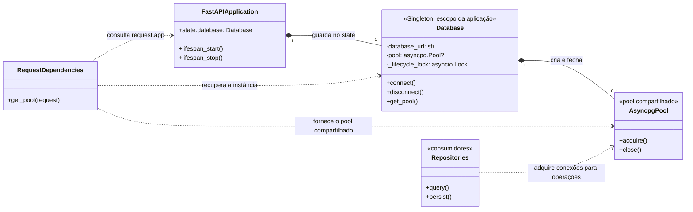
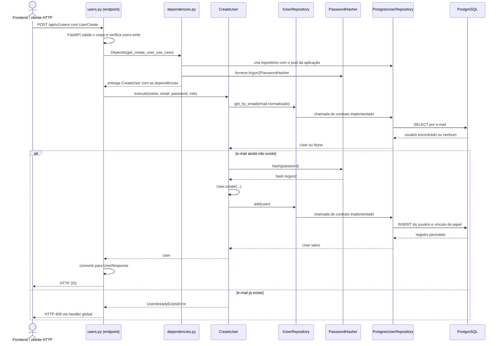

# Diagramas de classes e design patterns

Este documento registra a estrutura relevante do sistema implementada no repositório. O diagrama geral combina os módulos centrais do backend e os componentes frontend envolvidos nos padrões GoF. Em Python, os endpoints são funções organizadas em módulos; por isso aparecem como componentes `<<router>>`, não como classes literais.

Os estereótipos `<<Strategy>>`, `<<Observer>>` e `<<Facade>>` destacam os padrões GoF identificados no código. `<<Repository>>`, `<<DI>>` e `<<DTO>>` indicam conceitos arquiteturais ou de transferência de dados, fora do catálogo GoF.

## Diagrama de classes do sistema

```mermaid
classDiagram
    direction LR

    namespace Frontend {
        class DashboardComponents {
            <<UI>>
            +renderPages()
        }
        class ApiFacade {
            <<Facade>>
            +request(path, options)
            +listEquipments()
            +uploadThermographicImage()
            +createServiceOrder()
        }
        class AuthSessionStore {
            +getAuthSession()
            +saveAuthSession()
            +clearAuthSession()
        }
        class ProfilePage {
            +saveProfile()
            +dispatchProfileUpdated()
        }
        class DashboardShell {
            +subscribeProfileUpdated()
            +refreshProfileName()
        }
        class WindowEventTarget {
            <<event target>>
            +dispatchEvent(event)
            +addEventListener(type, callback)
            +removeEventListener(type, callback)
        }
    }

    namespace Presentation {
        class AuthRouter {
            <<router>>
            +handle_auth_requests()
        }
        class UsersRouter {
            <<router>>
            +handle_user_requests()
        }
        class EquipmentRouter {
            <<router>>
            +handle_equipment_requests()
        }
        class ThermographicImagesRouter {
            <<router>>
            +handle_thermography_requests()
        }
        class ServiceOrdersRouter {
            <<router>>
            +handle_service_order_requests()
        }
        class DashboardRouter {
            <<router>>
            +handle_dashboard_requests()
        }
        class RequestDependencies {
            <<DI>>
            +get_pool(request)
            +provide_repositories(pool)
            +provide_use_cases(...)
        }
        class UserDTOs {
            <<DTO>>
            +schemas: UserCreate, UserUpdate, UserResponse
        }
        class EquipmentDTOs {
            <<DTO>>
            +schemas: EquipmentCreate, EquipmentUpdate, EquipmentResponse
        }
        class ThermographyDTOs {
            <<DTO>>
            +imageSchema: ThermographicImageResponse
            +measurementSchemas: Request and Response
        }
        class ServiceOrderDTOs {
            <<DTO>>
            +serviceOrderSchemas: Create, Update, Response
            +checklistSchemas: Create, Update, Response
        }
    }

    namespace Application {
        class CreateUser {
            +execute(name, email, password, role)
        }
        class AuthenticateUser {
            +execute(email, password)
        }
        class UpdateUser {
            +execute(user_id, name, email, role)
        }
        class PasswordHasher {
            <<interface>>
            <<Strategy>>
            +hash(password)
            +verify(password, password_hash)
        }
    }

    namespace Domain {
        class User {
            <<entity>>
            id: UUID
            name: str
            email: str
            password_hash: str
            role: str
            +create(...)
        }
        class UserOption {
            <<value object>>
            id: UUID
            name: str
            email: str
        }
        class IUserRepository {
            <<interface>>
            <<Repository>>
            +get_by_email(email)
            +get_by_id(user_id)
            +add(user)
            +update_profile(...)
        }
        class EquipmentType {
            <<enum>>
            ELECTRIC_MOTOR
            PUMP
            ELECTRICAL_PANEL
            COMPRESSOR
            OTHER
        }
        class ServiceOrderStatus {
            <<enum>>
            BACKLOG, IN_PROGRESS
            WAITING_FOR_PART, UNDER_REVIEW
            COMPLETED, CANCELLED
        }
        class ServiceOrderPriority {
            <<enum>>
            LOW, MEDIUM, HIGH, CRITICAL
        }
    }

    namespace Infrastructure {
        class Database {
            <<Singleton: escopo da aplicação>>
            +connect()
            +disconnect()
            +get_pool()
            -_lifecycle_lock: asyncio.Lock
        }
        class AsyncpgPool {
            <<external>>
            +acquire()
            +close()
        }
        class PostgresUserRepository {
            +get_by_email(email)
            +get_by_id(user_id)
            +add(user)
            +update_profile(...)
        }
        class PostgresEquipmentRepository {
            <<PostgreSQL persistence>>
            +create(...)
            +get(id)
            +list(...)
            +update(...)
            +delete(id)
        }
        class PostgresThermographicImageRepository {
            <<PostgreSQL persistence>>
            +create(...)
            +get(id)
            +list(...)
            +update_thermal_overlay(...)
        }
        class PostgresServiceOrderRepository {
            <<PostgreSQL persistence>>
            +create(...)
            +get(id)
            +list(...)
            +update_status(...)
        }
        class PostgresRefreshTokenRepository {
            <<PostgreSQL persistence>>
        }
        class PostgresDashboardRepository {
            <<PostgreSQL persistence>>
            +get_summary(...)
        }
        class Argon2PasswordHasher {
            <<Strategy concrete>>
            +hash(password)
            +verify(password, password_hash)
        }
        class Is2ThermographyProcessor {
            +process(content, output_directory, file_id)
            +create_thermal_image(...)
            +create_thermal_overlay(...)
        }
        class GroqEquipmentAdvisor {
            <<external integration>>
            +get_equipment_advice(...)
            +get_thermographic_service_order_advice(...)
        }
        class EquipmentRecord {
            <<persisted record / response schema>>
            id, code, name, type
            manufacturer, temperature limits
        }
        class ThermographicImageRecord {
            <<persisted record / response schema>>
            id, equipment_id, file names
            analysis_metadata, created_at
        }
        class ServiceOrderRecord {
            <<persisted record / response schema>>
            id, code, title, status, priority
            client_id, equipment_id, technician_id
        }
        class ChecklistItemRecord {
            <<persisted record / response schema>>
            id, service_order_id, description
            required, completed, sort_order
        }
    }

    DashboardComponents --> ApiFacade : operações de API
    ApiFacade --> AuthSessionStore : sessão / renovação
    ApiFacade --> AuthRouter : HTTP
    ApiFacade --> EquipmentRouter : HTTP
    ApiFacade --> ThermographicImagesRouter : HTTP
    ApiFacade --> ServiceOrdersRouter : HTTP
    ProfilePage ..> WindowEventTarget : publica evento
    DashboardShell ..> WindowEventTarget : observa evento

    AuthRouter --> CreateUser : autenticação e cadastro
    AuthRouter --> AuthenticateUser : login
    UsersRouter --> UpdateUser : atualização de usuário
    EquipmentRouter --> PostgresEquipmentRepository : consulta direta
    ThermographicImagesRouter --> PostgresEquipmentRepository : limites do equipamento
    ThermographicImagesRouter --> PostgresThermographicImageRepository : persistência
    ThermographicImagesRouter --> Is2ThermographyProcessor : processamento IS2
    ThermographicImagesRouter --> GroqEquipmentAdvisor : sugestão de rascunho de OS
    ServiceOrdersRouter --> PostgresServiceOrderRepository : persistência
    DashboardRouter --> PostgresDashboardRepository : consultas
    RequestDependencies ..> Database : obtém pool
    RequestDependencies ..> PostgresUserRepository : compõe
    RequestDependencies ..> PostgresEquipmentRepository : compõe
    RequestDependencies ..> PostgresThermographicImageRepository : compõe
    RequestDependencies ..> PostgresServiceOrderRepository : compõe
    RequestDependencies ..> PostgresDashboardRepository : compõe
    RequestDependencies ..> Argon2PasswordHasher : compõe

    CreateUser --> IUserRepository : depende de
    AuthenticateUser --> IUserRepository : depende de
    UpdateUser --> IUserRepository : depende de
    CreateUser --> PasswordHasher : estratégia
    AuthenticateUser --> PasswordHasher : estratégia
    PasswordHasher <|.. Argon2PasswordHasher : implementa
    IUserRepository <|.. PostgresUserRepository : implementa
    PostgresUserRepository ..> AsyncpgPool : SQL
    PostgresEquipmentRepository ..> AsyncpgPool : SQL
    PostgresThermographicImageRepository ..> AsyncpgPool : SQL
    PostgresServiceOrderRepository ..> AsyncpgPool : SQL
    PostgresRefreshTokenRepository ..> AsyncpgPool : SQL
    PostgresDashboardRepository ..> AsyncpgPool : SQL
    Database *-- AsyncpgPool : ciclo de vida
    User ..> UserOption : projeção para seleção
    EquipmentRecord --> EquipmentType : tipo
    ServiceOrderRecord --> ServiceOrderStatus : estado
    ServiceOrderRecord --> ServiceOrderPriority : prioridade
    ServiceOrderRecord *-- ChecklistItemRecord : itens
    ThermographicImageRecord --> EquipmentRecord : equipamento_id

    UsersRouter ..> UserDTOs : valida entrada / saída
    EquipmentRouter ..> EquipmentDTOs : valida entrada / saída
    ThermographicImagesRouter ..> ThermographyDTOs : valida entrada / saída
    ServiceOrdersRouter ..> ServiceOrderDTOs : valida entrada / saída
```



### Notas de leitura

- O código possui entidade de domínio `User`; equipamento e ordem de serviço são representados principalmente por registros retornados pelos repositórios e por esquemas Pydantic. O desenho os marca como registros/esquemas para não sugerir entidades de domínio que não existem no código atual.
- `IUserRepository` é o único contrato formal de repositório no domínio. Os demais repositórios PostgreSQL são classes concretas dependidas diretamente pelos routers.
- Os routers de equipamento, imagens termográficas, ordens de serviço e dashboard usam os repositórios concretos em seus handlers. As dependências `get_*` também permitem compor alguns desses repositórios e casos de uso.
- O fluxo de envio de termografia instancia `Is2ThermographyProcessor` diretamente. Por isso, o processador aparece no diagrama de sistema, mas não é marcado como Strategy: não existe contrato intercambiável de processador no código atual.
- `Database` é a instância única usada pela aplicação FastAPI para manter o `asyncpg.Pool`; `dependencies.py` obtém esse mesmo pool por `app.state.database`. O escopo é uma instância da aplicação/worker, não um Singleton global compartilhado entre processos ou réplicas.

## Diagrama dos design patterns utilizados

Este diagrama isola os três padrões GoF com evidência clara de uso no sistema. O Repository e a injeção de dependência aparecem como mecanismos arquiteturais auxiliares, identificados com estereótipos próprios.

```mermaid
classDiagram
    direction TB

    namespace Strategy_Senha {
        class PasswordHasher {
            <<interface>>
            <<Strategy>>
            +hash(password)
            +verify(password, password_hash)
        }
        class Argon2PasswordHasher {
            <<ConcreteStrategy>>
            +hash(password)
            +verify(password, password_hash)
        }
        class CreateUser {
            <<Context>>
            +execute(...)
        }
        class AuthenticateUser {
            <<Context>>
            +execute(...)
        }
    }

    namespace Observer_Perfil {
        class ProfilePage {
            <<Subject / publisher>>
            +saveProfile()
            +dispatchProfileUpdated()
        }
        class WindowEventTarget {
            <<event channel>>
            +dispatchEvent(event)
            +addEventListener(type, callback)
            +removeEventListener(type, callback)
        }
        class DashboardShell {
            <<Observer / subscriber>>
            +refreshProfileName()
        }
    }

    namespace Facade_API {
        class DashboardComponents {
            <<client>>
            +listEquipments()
            +uploadThermographicImage()
            +createServiceOrder()
        }
        class ApiFacade {
            <<Facade>>
            +request(path, options)
            +refreshAuthSession()
            +describeError(value)
        }
        class AuthSessionStore {
            +getAuthSession()
            +saveAuthSession()
            +clearAuthSession()
        }
        class FetchAPI {
            <<HTTP transport>>
            +fetch(url, options)
        }
        class BackendAPI {
            <<subsystem>>
            +handleRestRequests()
        }
    }

    namespace Arquitetura_auxiliar {
        class IUserRepository {
            <<interface>>
            <<Repository>>
        }
        class PostgresUserRepository {
            <<concrete repository>>
        }
        class RequestDependencies {
            <<Dependency Injection>>
            +get_user_repository()
            +get_password_hasher()
            +provide_use_cases()
        }
    }

    PasswordHasher <|.. Argon2PasswordHasher : implementa
    CreateUser --> PasswordHasher : usa estratégia
    AuthenticateUser --> PasswordHasher : usa estratégia

    ProfilePage ..> WindowEventTarget : publica auth-profile-updated
    DashboardShell ..> WindowEventTarget : assina e remove assinatura

    DashboardComponents --> ApiFacade : chama interface simplificada
    ApiFacade --> AuthSessionStore : acessa sessão
    ApiFacade --> FetchAPI : HTTP, renovação e erros
    FetchAPI --> BackendAPI : requisições REST

    IUserRepository <|.. PostgresUserRepository : implementa
    RequestDependencies ..> PostgresUserRepository : instancia
    RequestDependencies ..> Argon2PasswordHasher : instancia
    RequestDependencies ..> CreateUser : fornece dependências
    RequestDependencies ..> AuthenticateUser : fornece dependências
```



| Padrão | Papel no sistema | Implementação |
|---|---|---|
| Strategy | Permite que os casos de uso dependam de uma política de hash definida por contrato. | `PasswordHasher` / `Argon2PasswordHasher` em cadastro e autenticação. |
| Observer | Notifica o shell quando o perfil foi atualizado, sem acoplamento direto entre as telas. | Evento `auth-profile-updated` publicado por `ProfilePage` e observado por `DashboardShell`. |
| Facade | Oferece aos componentes uma API frontend simplificada e centraliza detalhes de HTTP e sessão. | `frontend/lib/api.ts`, com `request()` e funções por recurso. |

Repository e injeção de dependência são mostrados como arquitetura auxiliar, não como padrões GoF. Para a análise de aderência, limitações e conceitos parecidos com padrões, consulte [DESIGN_PATTERNS.md](DESIGN_PATTERNS.md).

### Singleton — pool do banco de dados

O sistema mantém um pool `asyncpg` compartilhado durante o ciclo de vida de cada aplicação FastAPI. `create_app()` cria ou recebe um `Database`, guarda essa instância em `application.state.database`, conecta no `lifespan` e fecha o pool ao encerrar. As dependências HTTP recuperam o mesmo pool nas requisições. A trava de ciclo de vida serializa chamadas concorrentes a `connect()` e `disconnect()`, evitando a criação de dois pools no mesmo `Database`.



O Singleton aqui é **delimitado por aplicação**. Cada worker de servidor e cada réplica/container tem sua própria aplicação e, portanto, seu próprio pool. O pool não é uma conexão única: ele fornece conexões às operações concorrentes. `create_app(database=...)` continua permitindo injetar um `Database` alternativo, por exemplo em testes.

## Como o backend está organizado

O backend usa Python com FastAPI e separa responsabilidades em camadas. Em uma frase: **a API recebe e valida a requisição; um caso de uso coordena a ação quando existe; o domínio representa conceitos e regras centrais; a infraestrutura conversa com banco de dados, criptografia e serviços externos.**

```text
backend/app/
├── main.py                         cria a aplicação e gerencia o ciclo de vida
├── api/v1/router.py                reúne e versiona as rotas HTTP
├── presentation/
│   ├── http/                       endpoints, autenticação e dependências
│   └── schemas/                    formatos e validação de entrada/saída (DTOs)
├── application/
│   ├── use_cases/users/            ações da aplicação: criar, autenticar, atualizar
│   └── ports/                      contratos necessários à aplicação (ex.: hasher)
├── domain/
│   ├── entity/                     conceitos do domínio (User, enums)
│   ├── repositories/               contratos de persistência (IUserRepository)
│   └── exceptions/                 erros do domínio
├── infrastructure/
│   ├── database/                   pool e ciclo de vida do PostgreSQL
│   ├── persistence/                consultas e gravações SQL
│   ├── security/                   hash de senha e tokens
│   ├── thermography/               leitura e processamento IS2
│   ├── ai/                         integração com Groq
│   └── email/                      envio de e-mail de redefinição
└── core/                           configuração da aplicação
```

### Por que `CreateUser` e `UpdateUser`, em vez de colocar todas as operações em `User`?

`User` representa **um usuário** e seus dados (`id`, `name`, `email`, hash da senha, papel e data de criação). Também possui `User.create(...)`, que constrói uma instância válida com identificador e data. Isso é comportamento ligado à própria entidade.

`CreateUser` representa **uma ação do sistema**. Para cadastrar alguém, é preciso coordenar várias coisas: normalizar o e-mail, verificar se ele já existe, calcular o hash da senha, criar a entidade e pedir ao repositório para salvá-la. Essa sequência é um caso de uso da aplicação, não uma característica de um usuário individual.

`UpdateUser` coordena outra ação, com entradas e regras próprias. Manter essas ações em classes separadas deixa claro o propósito de cada uma, permite que cada caso receba apenas as dependências necessárias e evita transformar `User` numa classe que conhece banco de dados, hashing, autenticação e todas as operações da API. Essa divisão segue a separação entre **entidade** e **caso de uso** usada pela arquitetura em camadas/Clean Architecture.

Uma classe `User` com `create_user()`, `update_user()`, `delete_user()` e `authenticate()` acabaria misturando responsabilidades. Além disso, criar ou autenticar um usuário não é apenas alterar seus próprios campos: envolve consultas, segurança e persistência, que pertencem a outros componentes. O caso de uso coordena esse trabalho e a entidade continua focada em representar o usuário.

Isso não significa que todo método precise virar uma classe. Há operações simples, como algumas listagens, que hoje os endpoints executam diretamente usando repositórios. Os casos de uso explícitos estão concentrados principalmente no fluxo de usuários; outros módulos ainda têm lógica nos routers. O diagrama descreve esse estado atual, que aplica a separação de camadas de forma parcial.

### Exemplo completo: cadastrar um usuário



Neste exemplo, o tipo estático do repositório no caso de uso é `IUserRepository`, um contrato. A implementação concreta `PostgresUserRepository` é montada na camada de apresentação por `dependencies.py`; assim, o caso de uso não precisa executar SQL nem conhecer FastAPI.

### Caminho de uma requisição, em termos simples

1. **O frontend chama a API.** `frontend/lib/api.ts` encapsula chamadas HTTP, sessão e erros; no servidor, `backend/app/main.py` inclui o roteador sob `/api/v1`.
2. **O router escolhe o endpoint.** `api/v1/router.py` agrupa as rotas (`/users`, `/auth`, `/equipamentos`, `/imagens-termograficas`, `/ordens-servico` e `/dashboard`). O módulo HTTP valida o formato com esquemas Pydantic, checa autenticação/permissões e define o status/resposta HTTP.
3. **As dependências preparam recursos.** FastAPI resolve os parâmetros `Depends(...)`. `presentation/http/dependencies.py` obtém o pool de `request.app.state.database`, monta repositórios PostgreSQL e, nos fluxos que usam casos de uso, injeta seus contratos e implementações.
4. **A ação é executada.** Um caso de uso coordena a ação quando foi criado para aquele fluxo. Por exemplo, `CreateUser` coordena a verificação de duplicidade, hash, construção da entidade e persistência.
5. **A infraestrutura acessa recursos externos.** Repositórios usam `asyncpg` para o PostgreSQL; outros componentes processam arquivos IS2, geram tokens, enviam e-mails ou chamam Groq.
6. **A resposta retorna pela API.** O resultado é convertido em um esquema de resposta e FastAPI o serializa para JSON ou arquivo.

### Inicialização e banco de dados

`main.py` chama `create_app()`, registra middlewares, rotas e tratamento de exceções, e guarda `Database` no estado da aplicação. No `lifespan` do FastAPI, `Database.connect()` abre um pool `asyncpg` antes de atender requisições; no encerramento, `disconnect()` fecha o pool. Os handlers obtêm esse pool durante a resolução das dependências. A aplicação mantém um pool compartilhado pelas operações, em vez de abrir uma conexão nova dentro de cada endpoint.

### Pontos importantes para explicar a arquitetura com precisão

- **Router não é caso de uso.** O router conhece HTTP, status codes, parâmetros, esquemas e permissões. O caso de uso descreve a ação da aplicação sem precisar conhecer a requisição HTTP.
- **Entidade não é tabela nem endpoint.** `User` é o objeto de domínio criado pelo repositório. Os esquemas Pydantic, como `UserCreate` e `UserResponse`, são contratos de transporte; não são a entidade.
- **Repositório é a fronteira de persistência.** `IUserRepository` declara operações e `PostgresUserRepository` implementa essas operações com SQL. O repositório transforma os registros do banco em objetos `User`.
- **Injeção de dependência é montagem, não regra de negócio.** `Depends` e `get_*` ligam interfaces a implementações e fornecem recursos por requisição. A regra de cadastro continua em `CreateUser`.
- **A separação ainda não é uniforme.** Para usuário existem contrato formal de repositório e casos de uso. Em equipamento, termografia, ordens de serviço e dashboard, muitos endpoints usam repositórios concretos diretamente. É correto apresentar isso como uma arquitetura em camadas com adoção parcial dos casos de uso, não dizer que toda regra já está isolada na camada `application`.

### Explicação curta para apresentação

> “O backend é uma API FastAPI organizada em camadas. A apresentação recebe as requisições, valida os dados e controla autenticação e respostas. A camada de aplicação coordena casos de uso, como criar e autenticar usuários. O domínio contém os conceitos centrais, como `User`, e contratos como `IUserRepository`. A infraestrutura implementa esses contratos com PostgreSQL e integrações como Argon2, processamento termográfico e Groq. No cadastro, por exemplo, o endpoint entrega os dados ao `CreateUser`; ele verifica duplicidade, pede o hash da senha, cria a entidade `User` e salva pelo repositório PostgreSQL. Algumas áreas já seguem esse fluxo com casos de uso explícitos e outras ainda chamam repositórios diretamente.”
