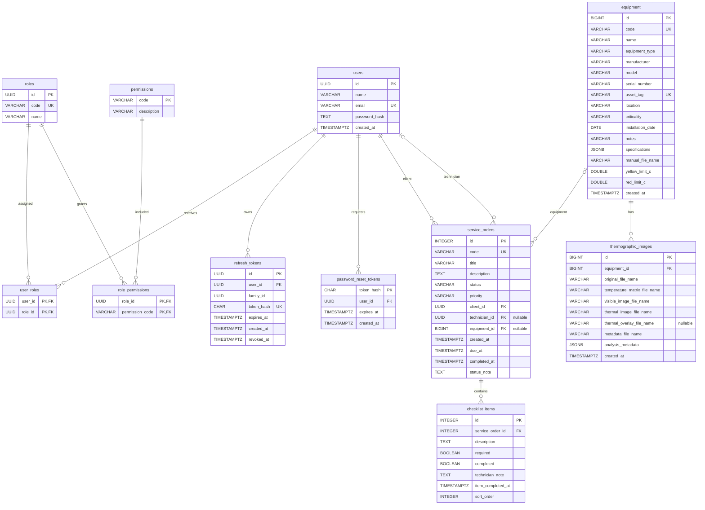

# Diagrama do banco de dados — PredictAI Thermography

Diagrama entidade-relacionamento reconstruído a partir das migrations `backend/migrations/001` a `012`. As entidades abaixo são tabelas PostgreSQL; `PK` indica chave primária, `FK` chave estrangeira e `UQ` unicidade.

## Regras e observações

- `user_roles` e `role_permissions` são tabelas de associação com chaves primárias compostas. Isso permite relacionar vários usuários a várias roles e várias roles a várias permissões.
- `service_orders.client_id` é obrigatório e impede a exclusão do usuário associado (`ON DELETE RESTRICT`). `technician_id` é opcional e vira `NULL` se o usuário for removido (`ON DELETE SET NULL`). `equipment_id` também é opcional e vira `NULL` quando o equipamento é removido.
- Remover um usuário exclui suas sessões e tokens de redefinição (`ON DELETE CASCADE`). Remover uma ordem de serviço exclui seus itens de checklist; remover equipamento exclui suas imagens termográficas.
- O banco limita `status` e `priority` das ordens por `CHECK`. Os limites térmicos do equipamento devem estar ambos definidos ou ambos nulos, e o limite vermelho deve ser maior que o amarelo.
- `analysis_metadata` e `specifications` são `JSONB`; seus atributos internos não são colunas relacionais representadas neste ERD.
- As migrations criam as roles `user` e `admin`; não criam uma role `technician`. A tabela de ordens referencia o técnico por `users.id`. No código atual, `list_user_options()` retorna todos os usuários, então o banco não restringe essa atribuição a usuários com perfil técnico.
- A tabela `equipment` não tem `client_id`/proprietário. A relação da ordem com o equipamento é opcional e fica em `service_orders.equipment_id`.

## Origem

`backend/migrations/001_create_users.sql` a `backend/migrations/012_add_thermal_overlay.sql`.
