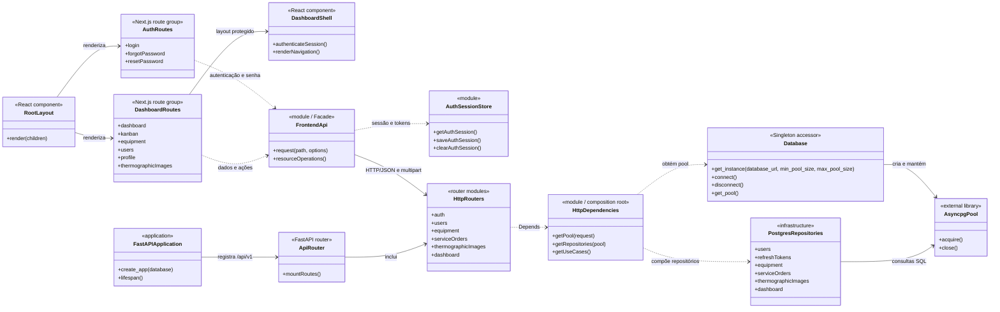
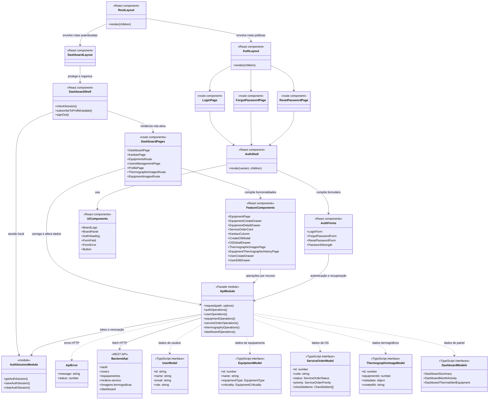

# Diagramas de classes do PredictAI Thermography

Este documento apresenta uma visão UML do projeto atual, cobrindo frontend e backend. Os diagramas estão separados por responsabilidade para permanecerem legíveis.

> **Como ler:** no backend, entidades, schemas e classes Python representam tipos reais. Routers, módulos funcionais e serviços baseados em funções estão marcados como `<<module>>` ou `<<router>>`; são representações de responsabilidades do código, não classes Python instanciáveis. No frontend, componentes React são funções e estão marcados como `<<React component>>`; os modelos TypeScript são interfaces ou tipos.

## 1. Visão geral da aplicação

## 2. Domínio, aplicação e persistência

```mermaid
classDiagram
    direction TB

    class User {
        <<domain entity>>
        +id: UUID
        +name: str
        +email: str
        +password_hash: str
        +created_at: datetime
        +permissions: tuple
        +role: str
        +create(name, email, password_hash, role)$ User
    }
    class UserOption {
        <<domain value data>>
        +id: UUID
        +name: str
        +email: str
    }
    class IUserRepository {
        <<Protocol>>
        +get_by_email(email) User
        +get_by_id(user_id) User
        +list_users(limit, offset, query) list
        +update_profile(user_id, name, email, role) User
        +add(user) User
        +delete(user_id) bool
    }
    class PostgresUserRepository {
        -pool: asyncpg.Pool
        +get_by_email(email) User
        +get_by_id(user_id) User
        +list_users(...)
        +update_profile(...)
        +add(user) User
    }
    class PasswordHasher {
        <<Protocol / Strategy>>
        +hash(password) str
        +verify(password, password_hash) bool
    }
    class Argon2PasswordHasher {
        +hash(password) str
        +verify(password, password_hash) bool
    }
    class CreateUser {
        -repository: IUserRepository
        -password_hasher: PasswordHasher
        +execute(name, email, password, role) User
    }
    class AuthenticateUser {
        -repository: IUserRepository
        -password_hasher: PasswordHasher
        +execute(email, password) User
    }
    class UpdateUser {
        -repository: IUserRepository
        +execute(user_id, name, email, role) User
    }
    class EquipmentType {
        <<StrEnum>>
        MOTOR_ELETRICO
        BOMBA
        PAINEL_ELETRICO
        COMPRESSOR
        OUTRO
    }
    class ServiceOrderStatus {
        <<StrEnum>>
        BACKLOG
        EM_ANDAMENTO
        AGUARDANDO_PECA
        EM_REVISAO
        CONCLUIDO
        CANCELADO
    }
    class ServiceOrderPriority {
        <<StrEnum>>
        BAIXA
        MEDIA
        ALTA
        CRITICA
    }
    class PostgresEquipmentRepository {
        -pool: asyncpg.Pool
        +create(data)
        +list(...)
        +update(...)
    }
    class PostgresServiceOrderRepository {
        -pool: asyncpg.Pool
        +create(data)
        +list(...)
        +kanban()
        +update_status(...)
        +update_checklist(...)
    }
    class PostgresThermographicImageRepository {
        -pool: asyncpg.Pool
        +create(data)
        +list(...)
        +get(...)
    }
    class PostgresDashboardRepository {
        -pool: asyncpg.Pool
        +summary()
        +thermal_alerts()
    }
    class PostgresRefreshTokenRepository {
        -pool: asyncpg.Pool
        +create(...)
        +rotate(...)
    }
    class Database {
        -pool: asyncpg.Pool?
        +get_instance(database_url, min_pool_size, max_pool_size) Database
        +connect()
        +disconnect()
        +get_pool() asyncpg.Pool
    }

    IUserRepository <|.. PostgresUserRepository
    PasswordHasher <|.. Argon2PasswordHasher
    CreateUser --> IUserRepository : usa
    CreateUser --> PasswordHasher : usa
    AuthenticateUser --> IUserRepository : usa
    AuthenticateUser --> PasswordHasher : usa
    UpdateUser --> IUserRepository : usa
    User --> UserOption : opções derivadas
    Database --> PostgresUserRepository : fornece pool
    Database --> PostgresEquipmentRepository : fornece pool
    Database --> PostgresServiceOrderRepository : fornece pool
    Database --> PostgresThermographicImageRepository : fornece pool
    Database --> PostgresDashboardRepository : fornece pool
    Database --> PostgresRefreshTokenRepository : fornece pool
    PostgresEquipmentRepository ..> EquipmentType : persiste tipo
    PostgresServiceOrderRepository ..> ServiceOrderStatus : consulta status
    PostgresServiceOrderRepository ..> ServiceOrderPriority : consulta prioridade
```

**Nota de modelagem:** atualmente, `User` é a principal entidade de domínio. Equipamentos, ordens de serviço e imagens termográficas são manipulados principalmente por repositórios PostgreSQL e schemas HTTP; o backend não declara entidades de domínio próprias equivalentes a `Equipment` ou `ServiceOrder`. Os enums de tipo, status e prioridade estão no domínio.

## 3. API, schemas e serviços de infraestrutura

```mermaid
classDiagram
    direction TB

    class ApiRouter {
        <<FastAPI router>>
        +auth
        +users
        +equipment
        +serviceOrders
        +thermographicImages
        +dashboard
    }
    class AuthRouter {
        <<router module>>
        +login(LoginRequest) TokenResponse
        +refresh(RefreshRequest) TokenResponse
        +forgotPassword(ForgotPasswordRequest)
        +resetPassword(ResetPasswordRequest)
    }
    class UsersRouter {
        <<router module>>
        +createUser(UserCreate) UserResponse
        +updateUser(UserUpdate) UserResponse
        +listUsers()
        +getCurrentUser()
    }
    class EquipmentRouter {
        <<router module>>
        +createEquipment(EquipmentCreate) EquipmentResponse
        +listEquipments()
        +updateEquipment(EquipmentUpdate) EquipmentResponse
        +adviseProblem() EquipmentAdviceResponse
    }
    class ServiceOrdersRouter {
        <<router module>>
        +create(ServiceOrderCreate) ServiceOrderResponse
        +getKanban() KanbanBoardResponse
        +updateStatus(ServiceOrderStatusUpdate) ServiceOrderResponse
        +updateChecklist(ChecklistItemUpdate)
    }
    class ThermographicImagesRouter {
        <<router module>>
        +upload(file) ThermographicImageResponse
        +list() list~ThermographicImageResponse~
        +measureRegion(request) ThermographicRegionMeasurementResponse
        +downloadAsset()
    }
    class DashboardRouter {
        <<router module>>
        +getSummary() DashboardSummaryResponse
        +getThermalAlerts() list~DashboardThermalAlertEquipment~
    }
    class HttpDependencies {
        <<composition functions>>
        +get_current_user()
        +require_permissions(...)
        +get_pool(request)
        +get_*_repository(pool)
        +get_*_use_case(...)
    }
    class UserSchemas {
        <<Pydantic schemas>>
        UserCreate
        UserUpdate
        UserResponse
        LoginRequest
        TokenResponse
        RefreshRequest
        ResetPasswordRequest
    }
    class EquipmentSchemas {
        <<Pydantic schemas>>
        EquipmentCreate
        EquipmentUpdate
        EquipmentResponse
        EquipmentAdviceRequest
        EquipmentAdviceResponse
    }
    class ServiceOrderSchemas {
        <<Pydantic schemas>>
        ServiceOrderCreate
        ServiceOrderUpdate
        ServiceOrderResponse
        ServiceOrderStatusUpdate
        ChecklistItemCreate
        ChecklistItemUpdate
        ChecklistItemResponse
        KanbanBoardResponse
    }
    class ThermographySchemas {
        <<Pydantic schemas>>
        ThermographicImageResponse
        ThermographicRegionMeasurementRequest
        ThermographicRegionMeasurementResponse
    }
    class DashboardSchemas {
        <<Pydantic schemas>>
        DashboardSummaryResponse
        DashboardMonthActivity
        DashboardThermalAlertEquipment
    }
    class Is2ThermographyProcessor {
        +process(content, outputDirectory, fileId) ProcessedThermography
    }
    class ProcessedThermography {
        <<dataclass>>
        +matrix_file_name: str
        +visible_image_file_name: str
        +thermal_image_file_name: str
        +thermal_overlay_file_name: str
        +metadata_file_name: str
        +metadata: dict
    }
    class GroqAdvisorModule {
        <<module>>
        +get_equipment_advice(...)
        +get_thermographic_service_order_advice(...)
        +extract_relevant_manual_text(...)
    }
    class SecurityModules {
        <<modules>>
        +access_tokens
        +refresh_tokens
        +password_reset_tokens
    }
    class PasswordResetEmailModule {
        <<module>>
        +send_password_reset_email(...)
    }
    class PostgresRepositories {
        <<infrastructure classes>>
        +PostgresUserRepository
        +PostgresRefreshTokenRepository
        +PostgresEquipmentRepository
        +PostgresServiceOrderRepository
        +PostgresThermographicImageRepository
        +PostgresDashboardRepository
    }

    ApiRouter --> AuthRouter : inclui
    ApiRouter --> UsersRouter : inclui
    ApiRouter --> EquipmentRouter : inclui
    ApiRouter --> ServiceOrdersRouter : inclui
    ApiRouter --> ThermographicImagesRouter : inclui
    ApiRouter --> DashboardRouter : inclui
    AuthRouter ..> UserSchemas : valida entrada e saída
    UsersRouter ..> UserSchemas : valida entrada e saída
    EquipmentRouter ..> EquipmentSchemas : valida entrada e saída
    ServiceOrdersRouter ..> ServiceOrderSchemas : valida entrada e saída
    ThermographicImagesRouter ..> ThermographySchemas : valida entrada e saída
    DashboardRouter ..> DashboardSchemas : valida resposta
    AuthRouter ..> HttpDependencies : injeta dependências
    UsersRouter ..> HttpDependencies : injeta dependências
    EquipmentRouter ..> HttpDependencies : injeta dependências
    ServiceOrdersRouter ..> HttpDependencies : injeta dependências
    ThermographicImagesRouter ..> HttpDependencies : injeta dependências
    DashboardRouter ..> HttpDependencies : injeta dependências
    HttpDependencies ..> PostgresRepositories : compõe
    AuthRouter ..> SecurityModules : tokens e credenciais
    AuthRouter ..> PasswordResetEmailModule : envio assíncrono
    EquipmentRouter ..> GroqAdvisorModule : sugestão de manutenção
    ThermographicImagesRouter ..> Is2ThermographyProcessor : processa arquivo IS2
    Is2ThermographyProcessor ..> ProcessedThermography : produz
    ThermographicImagesRouter ..> GroqAdvisorModule : rascunho de OS
```

## 4. Frontend: rotas, componentes e API

## 5. Referências no código

- Aplicação e composição backend: `backend/app/main.py`, `backend/app/api/v1/router.py`, `backend/app/presentation/http/dependencies.py`.
- Domínio e casos de uso: `backend/app/domain/`, `backend/app/application/`.
- Repositórios, pool e serviços: `backend/app/infrastructure/`.
- Schemas HTTP: `backend/app/presentation/schemas/`.
- Rotas e componentes frontend: `frontend/app/`, `frontend/components/`.
- Cliente da API e contratos TypeScript: `frontend/lib/api.ts`, `frontend/lib/auth-session.ts`.
- Modelo relacional do PostgreSQL: [DIAGRAMA_BANCO_DADOS.md](DIAGRAMA_BANCO_DADOS.md).
- Padrões GoF e explicações: [DESIGN_PATTERNS.md](DESIGN_PATTERNS.md).
